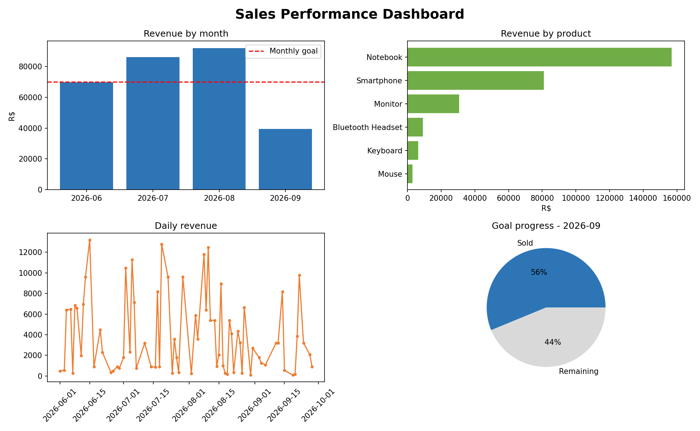

# Sales Performance Dashboard

A Python project that turns raw sales data into clear, actionable numbers: monthly revenue, best-selling products, average ticket, goal progress and estimated commission.

Built from a salesperson's point of view: the metrics are the ones a seller actually checks to know *"Am I going to hit my goal this month?"*



## Features

- Reads sales data from a CSV file
- Calculates monthly revenue, average ticket, top product and revenue by product
- Tracks progress toward a monthly sales goal and shows how much is left
- Estimates commission based on a configurable rate
- Generates a 4-chart dashboard image and a summary in the terminal

## Tech stack

- **Python 3.10+**
- **pandas** for data loading and aggregation
- **matplotlib** for visualization

## Getting started

```bash
# 1. Clone the repository
git clone https://github.com/<your-username>/sales-performance-dashboard.git
cd sales-performance-dashboard

# 2. Install dependencies
pip install -r requirements.txt

# 3. (Optional) Generate a new fictional dataset
python src/generate_data.py

# 4. Run the dashboard
python src/dashboard.py
```

The dashboard image is saved to `images/dashboard.png`.

## Configuration

Open `src/dashboard.py` and change these values at the top of the file:

| Setting | Description | Default |
|---|---|---|
| `MONTHLY_GOAL` | Monthly sales goal (R$) | `70000` |
| `COMMISSION_RATE` | Commission on revenue | `0.03` (3%) |

## Data

The file `data/sales_sample.csv` contains **fictional data** created for practice purposes. To use your own data, keep the same columns:

`date, product, quantity, revenue, customer`

## Project structure

```
sales-performance-dashboard/
├── data/
│   └── sales_sample.csv      # fictional sales data
├── images/
│   └── dashboard.png         # generated dashboard
├── src/
│   ├── generate_data.py      # creates the sample dataset
│   └── dashboard.py          # metrics + charts
├── requirements.txt
└── README.md
```

## Roadmap

- [ ] Sales forecast for the next month using linear regression (scikit-learn)
- [ ] Interactive web version with Streamlit
- [ ] Excel report export
- [ ] Sales by customer and customer ranking

## About

Created by **Mateus Jeronimo**, a sales professional who is learning data analytics and machine learning to sell with numbers, not just intuition.
